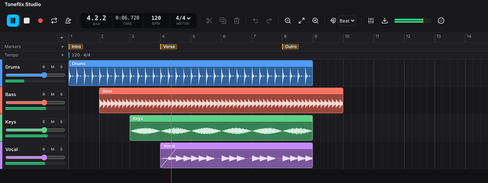

# Toneflix Studio



**The studio engine for the web.** Give any web app a real multitrack editor. Your users arrange, cut and shape audio as freely as in a desktop DAW, right in the browser.

- **Edit without limits.** Split anything, drag clips anywhere, layer them and move them between tracks. Nothing snaps back unless you ask it to.
- **Fast with big sessions.** Waveforms are drawn in the background and cached on the device, so long recordings open instantly the next time.
- **Fits any stack.** No framework and no dependencies. Restyle it with CSS variables and drop in your own track controls.
- **Open by design.** MIT licensed. Project exchange with the desktop DAWs musicians already use is on the roadmap.

Read the docs and try the playground at **[toneflix.github.io/studio](https://toneflix.github.io/studio/)**.

> Status: early. This release has the timeline and waveforms. Playback and recording come next.

## Use

```ts
import { StudioTimeline, Waveforms, makeClip, uid } from '@toneflix/studio';

const timeline = new StudioTimeline(document.getElementById('editor')!, {
  grid: { bpm: 120, meter: [4, 4], snap: 'beat' },
  createTrack: () => ({ id: uid('t'), name: 'New stem' }),
});

timeline.load({
  tracks: [{ id: 'vox', name: 'Vocals' }],
  clips: [makeClip({ track: 'vox', source: 'vox.wav', start: 0, offset: 0, duration: 12 })],
});

// Peaks are worked out in a worker and kept in Cache Storage, so a stem is analysed once per device
const waveforms = new Waveforms();
const peaks = await waveforms.get('vox.wav:v1', () => audioContext.decodeAudioData(bytes));
timeline.setSource({ id: 'vox.wav', duration: 12 }, peaks);

timeline.on('change', ({ state, final }) => final && save(state));
```

## Editing

| Gesture | What it does |
| --- | --- |
| Drag a clip | Moves it in time and to other lanes; past or over other clips. Below the last lane makes a new one (with `createTrack`) |
| Drag a clip edge | Trims it, up to the ends of its audio |
| Drag a corner handle | Fade in or out |
| Click, Shift or Ctrl/Cmd click | Select, add to or toggle the selection |
| Drag on an empty lane or the ruler | Selects a time range; with Shift, selects the clips inside it |
| Alt while dragging | Turns snapping off |
| Ctrl/Cmd + wheel | Zoom around the pointer |
| S, Delete, Ctrl+D, Ctrl+A | Split at the playhead, delete, duplicate, select all |
| Arrows | Nudge by the snap step, or move up and down a lane |
| Ctrl+Z, Ctrl+Shift+Z | Undo and redo |

Where clips overlap on a lane, the one that starts later is on top and is the one heard. `audibleRanges(clips)` gives the heard part of each clip, for players and mix renderers.

## Packages

Install `@toneflix/studio` for everything, or only the parts your app uses. Every package is released with the same version.

| Package | What it gives you |
| --- | --- |
| [`@toneflix/studio`](packages/studio) | Everything below, from one import |
| [`@toneflix/studio-core`](packages/core) | Tracks, clips, pure edits (`splitClips`, `moveClips`, `trimStart`, `setFades`…), snapping, `TimelineModel` and `History`. No DOM or audio, so it also runs on servers and in tests |
| [`@toneflix/studio-waveforms`](packages/waveforms) | `Waveforms`, `PeaksWorker`, `PeaksCache` and `drawWaveform`: peaks off the main thread, cached on the device |
| [`@toneflix/studio-timeline`](packages/timeline) | `StudioTimeline`, the editor view. Restyle it with the `--tfs-*` CSS variables or fill track headers with `renderHeader` |

Playback and recording will arrive as their own packages.

## Develop

```sh
pnpm install
pnpm test        # node --test, no browser needed
pnpm demo        # the demo page with made-up audio
pnpm docs:dev    # the docs site with a live playground
pnpm build       # each package's dist/ with type declarations
```

## Release

Publish a GitHub release tagged with the version, like `v0.2.0`. The Publish workflow takes the version from the tag, runs the checks, publishes every package to npm and saves the version in each `package.json` on the default branch. A release marked as a pre-release goes out under the `next` tag.

To publish without a release, run the Publish workflow from the Actions tab with a version and a dist-tag.

## License

MIT
